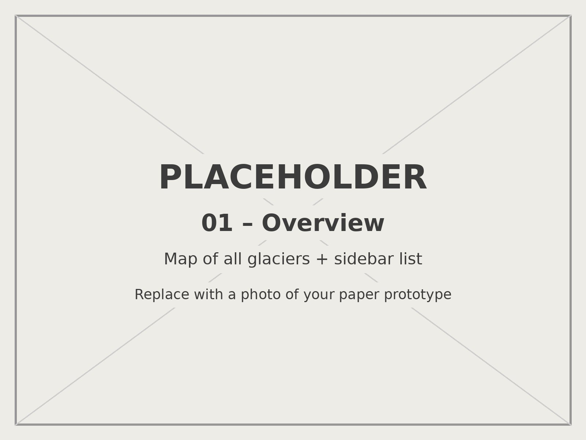

# 01 – Overview

- **Description:** Screen showing all Swiss glaciers as an overview. A sidebar on the right lists all glaciers, sorted by mass.
- **Trigger:** Click on a glacier outline
- **Response:** The side panel opens and the glacier is highlighted → see `02_glacier_selected`
- **Data:** `data/length_change.csv` → columns glacier_id, year, cumulative_length; `data/inventory_2016.geojson` → name, area
- **States:** Selected glacier showing / Glacier data missing / No glacier selected / Loading data
- **Remarks:** The sidebar should make clear which year the data represents.
