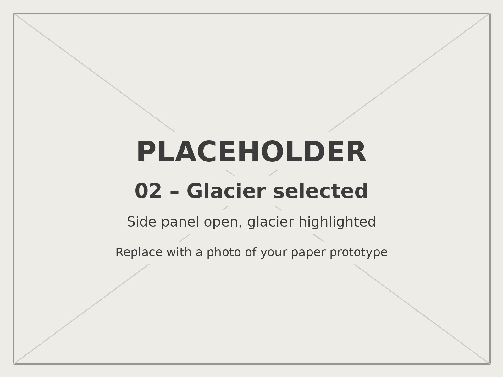

# 02 – Glacier selected

- **Description:** [Description of the screen]
- **Trigger:** [Actions/triggers a user can do on this screen]
- **Response:** [What happens after a trigger has been used. If it leads to another screen, name its folder.]
- **Data:** [Which file and columns from the `data/` folder are used]
- **States:** [Different states this screen can have. Add a photo per state to this folder if useful.]
- **Remarks:** [Anything else that seems important]
